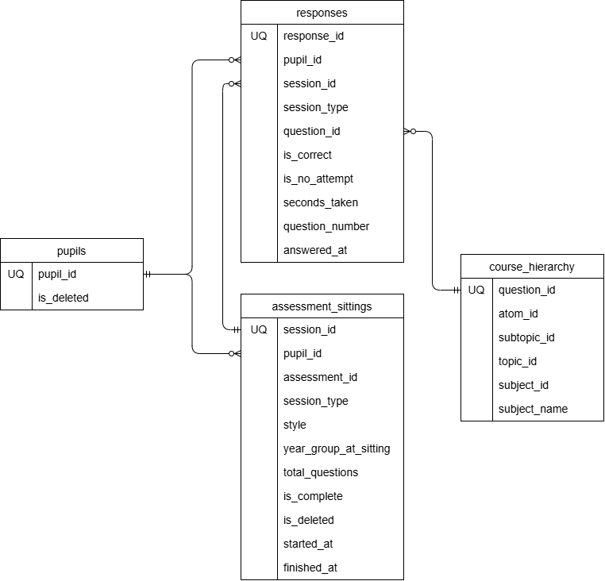

# atom-analytics - take home test

In the interests of working to keep the time spent on this work down to around two hours, it made sense to mostly prototype this work using Claude. I spent a small amount of time profiling the data in the raw tables and mapping out the apparent structure first to get the problem clear in my head. This enabled me to read the code generated by Claude with a broad level of understanding of where this needed to head. I think that the code does allow for recreation of point in time analysis and with partitioning and clustering on tables that are likely to grow fast, should be future proof. But this is something that would need monitoring over time. Due to time constraints I haven't tested the code produced by Claude as thoroughly as I would like, so this would be also be a next step. I would also suggest adapting this solution in line with design patterns of similar projects at ATOM to achieve a more easily maintainable result. I've identified some assumptions and data quality issues below, but this is by no means an exhaustive list, and before any data set was ready for production I would want to dig deeper into the data and make sure that I understood all of the data items, their business context and what, based on SME knowledge, would be a valid way manage those data.

The final table in this analysis, fct_sats_score_history, is the last step before this data would be ready to go into the application database. But there could be another query beyond this depending on how much historic data is wanted for the application database and if a specific format is required. In the population of this final table, the methodology used was to generate a SATs score per sitting. This may be volatile and may not be what is wanted, so it would need to be clarified what makes sense with subject experts and the way that it will be presented and described within the application itself to see if an average of some description is better. Also showing results for all years, not just year 5/6, so this may also need further consideration. 

Once the data is considered to be valid and robust, it would then need to be built in line with Atom tools and design patterns, but for the purpose of this exercise I have kept the creation/population of data simple, using the Google Cloud CLI

## Prerequisites
* install [Google Cloud CLI](https://docs.cloud.google.com/sdk/docs/install-sdk#deb)
* initiate gcloud and authenticate with GCP:
```bash
gcloud init
```
* Set project
```bash
gcloud config set project project-name
```
## Assumptions / Notes / Missing info
- Based on the source data and the task description the table structure of the raw data is: 
- If a pupil has an **is_deleted** flag of True, should they not be brought through into the data platform and if they already exist in the data platform they should be removed? This does mean that 'point in time' analysis for those pupils cannot be recreated, and any summary statistics that were generated across all pupils will also change.
- According to https://www.gov.uk/guidance/understanding-scaled-scores-at-key-stage-2#scaled-score-conversion-tables subjects that are graded for SATS are 
  - English grammar, punctuation and spelling
  - English reading
  - Mathematics
This doesn't map exactly to the courses in course_hierarchy. My assumption is that 'Maths' can map to 'mathematics' and 'English' is probably most closely mapped to 'English reading', but this assumption would need to be verified with someone who understands the contents of the Atom tests and how they map to the SAT's tests


### Data Quality Issues
Not exhaustive, just a couple of high level sanity checks. For production code would want to go into more detail here and also understand the business rules around this data to build into the data quality checking.
- Quick profile of data shows that all rows from the raw tables have come through into the staging area. But would want to look at more details such as whether mandatory fields are populated. [Link to SQL](/SQL/data_quality/raw_and_stg_counts.sql)
- Not all pupils have a record in assessment_sittings, and not all assessment_sittings have responses. Is this missing data? e.g. is it possible for an assessment to be sat and no question responses recorded?
If they don't have any assessment sittings and  a SAT score cannot be calculated for them. [Link to SQL](/SQL/data_quality/pupils_without_sittings_or_responses.sql)


### To create the BQ Objects in a new BQ project
* Create staging tables
```bash
bq query --use_legacy_sql=false < SQL/Staging/ddl/stg_pupils.sql
bq query --use_legacy_sql=false < SQL/Staging/ddl/stg_course_hierarchy.sql
bq query --use_legacy_sql=false < SQL/Staging/ddl/stg_assessment_sittings.sql
bq query --use_legacy_sql=false < SQL/Staging/ddl/stg_responses.sql
```
* Create and populate reference tables
```bash
bq query --use_legacy_sql=false < SQL/Reference/ddl/ref_ks2_scaled_score_conversion.sql
bq query --use_legacy_sql=false < SQL/Reference/load/ref_ks2_scaled_score_conversion.sql
bq query --use_legacy_sql=false < SQL/Reference/ddl/ref_subject_ks2_mapping.sql
bq query --use_legacy_sql=false < SQL/Reference/load/ref_subject_ks2_mapping.sql
```

* Create Intermediate tables
```bash
bq query --use_legacy_sql=false < SQL/Intermediate/ddl/int_pupil_subject_session_summary.sql
bq query --use_legacy_sql=false < SQL/Intermediate/ddl/model_run_log.sql
bq query --use_legacy_sql=false < SQL/Intermediate/ddl/int_changed_pupils.sql
bq query --use_legacy_sql=false < SQL/Intermediate/ddl/int_sats_sitting_scores_as_of.sql
```
* Create fact tables
```bash
bq query --use_legacy_sql=false < SQL/Fact/ddl/fct_sats_score_history.sql
```


### Load of data when new raw data is available
* Merge any new data from raw tables into staging tables
```bash
bq query --use_legacy_sql=false < SQL/Staging/load/stg_pupils.sql
bq query --use_legacy_sql=false < SQL/Staging/load/stg_course_hierarchy.sql
bq query --use_legacy_sql=false < SQL/Staging/load/stg_assessment_sittings.sql
bq query --use_legacy_sql=false < SQL/Staging/load/stg_responses.sql
```
* Add updates to the pupil subject session summary table
```bash
bq query --use_legacy_sql=false < SQL/Intermediate/load/int_pupil_subject_session_summary.sql
```
* Rebuild the pupil/subject SATS score history table
```bash
bq query --use_legacy_sql=false < SQL/Fact/load/fct_sats_score_history.sql
```

### Step 3: How would you predict a pupil's GCSE results from their primary-school work?

There is a lot that can happen between primary school and GCSEs and individual circumstances could make a huge difference, so you would need to be very careful about how any attempt to predict a pupil's GCSE results based on their primary school work is carried out and presented. In fact I would argue that this is very difficult on an individual basis although it could be useful as an examination of broad trends to show how you could potentially increase GCSE results on an aggregate scale by focussing on primary school work.

The first thing that would need to be established is that there is a correlation between primary-school work and GCSEs. The most comprehensive data set to use to try and do that would probably be to look at the relationships between pupils' SATs scores and their subsequent GCSE results. If you can establish a relationship between the two, the analysis would be strengthened by being able to normalise it for pupil demographic characteristics to make sure that the effect being observed is statistiscally significant. 

